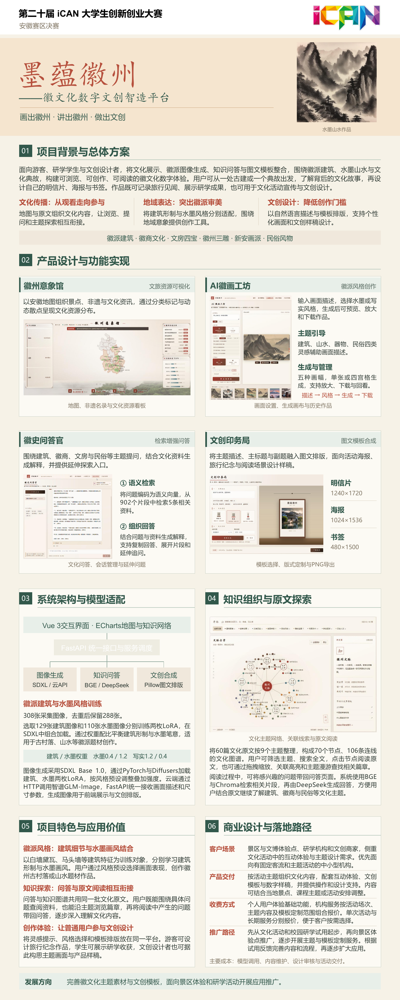
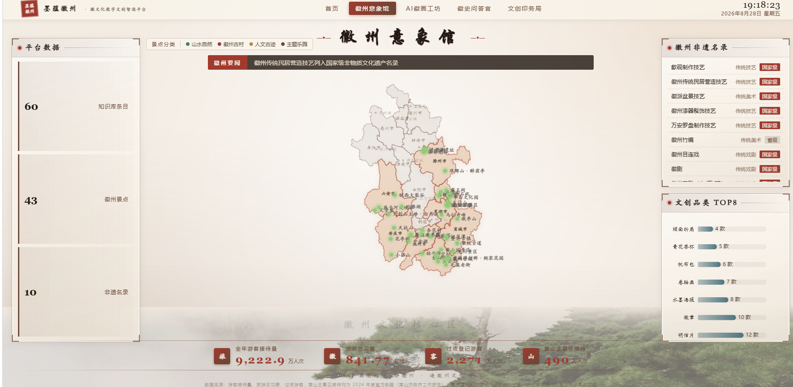
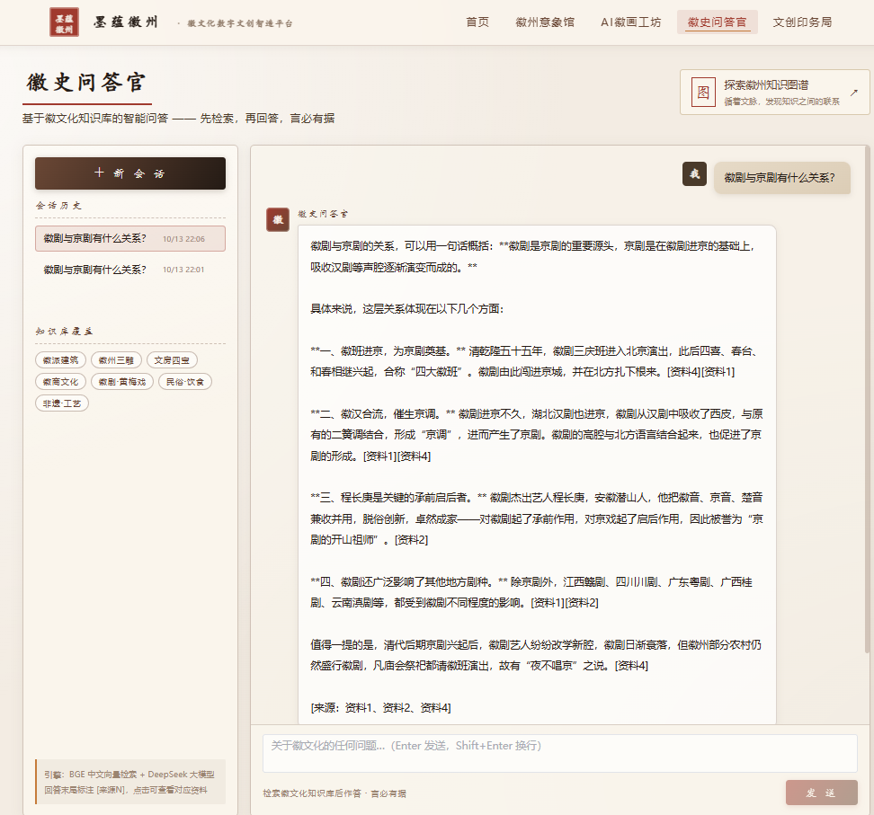
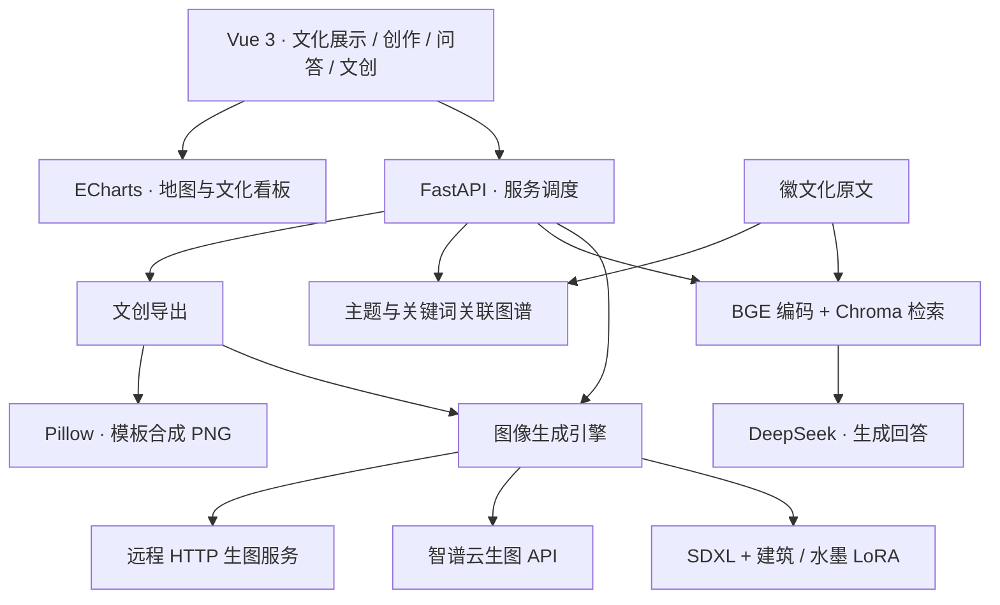

<h1 align="center">墨蕴徽州 · Moyun Huizhou</h1>

<p align="center">徽文化数字文创智造平台<br>画出徽州，讲出徽州，做出文创</p>

<p align="center">
  <a href="LICENSE"></a>
  
  
  
</p>

墨蕴徽州是一套面向文化体验与数字文创设计的 AIGC 平台，围绕徽派建筑、皖南山水与传统技艺，将文化展示、图像创作、知识问答、原文探索和文创排版整合到同一网站。

游客可以从一处古村或一个文化主题出发，了解背后的故事，生成自己的画作，再制作明信片、海报或书签。研学学生可以带着问题查阅资料、沿知识图谱展开阅读，并把学习成果转化为作品。景区、学校和活动组织者可以围绕主题开展文化互动与创作活动。

项目参加 **2026 年 iCAN 大学生创新创业大赛创新赛道·智慧文创方向**。

[功能介绍](#功能介绍) · [省赛海报](#省赛海报) · [界面预览](#界面预览) · [架构与技术栈](#架构与技术栈) · [快速开始](#快速开始) · [未来工作](#未来工作)

## 项目特色

- **徽派题材与水墨风格结合**：针对徽派建筑和水墨画风分别训练 LoRA，通过组合权重与风格预设，让用户选择适合的画面表现。
- **问答与原文探索相连**：同一批徽文化资料同时用于语义检索和主题图谱，支持从问题找到资料，再沿篇章关联继续阅读。
- **文化体验与文创设计结合**：围绕同一主题完成文化浏览、图像生成和模板排版，让学习、创作与成果展示衔接起来。
- **统一的徽州视觉语言**：宣纸、水墨、朱砂与鎏金贯穿页面和文创模板，形成一致的产品体验。

## 功能介绍

| 模块 | 功能 | 页面 |
| --- | --- | --- |
| 徽州意象馆 | 安徽地图、文化景点分布、非遗名录与文旅看板 | `/bigscreen` |
| AI 徽画工坊 | 灵感提示词、水墨与写实风格、五种画幅、单张与四宫格生成、放大下载和近期作品 | `/studio` |
| 徽史问答官 | BGE 语义检索、DeepSeek 生成回答、资料片段查看与会话管理 | `/ask` |
| 知识图谱 | 主题筛选、篇名与全文搜索、原文阅读、关键词关联与延伸提问 | `/ask/knowledge` |
| 文创印务局 | 输入画面描述、标题与副题，选择模板，合成并下载 PNG 样稿 | `/craft` |

知识图谱集成在问答模块中，按文化主题与共同关键词组织原文，让用户从一篇资料出发探索相关篇章。

### 文创模板

| 模板 | 尺寸 | 用途 |
| --- | --- | --- |
| 明信片 | 1240 × 1720 | 旅行纪念、主题活动与作品分享 |
| 海报 | 1024 × 1536 | 活动宣传、文化主题展示 |
| 书签 | 480 × 1500 | 阅读纪念与研学成果 |

## 省赛海报

<p align="center">
  <a href="assets/poster.png"></a>
</p>

## 界面预览

### 徽州意象馆



<details>
<summary>AI 徽画工坊：描述画面、选择风格、比较作品</summary>


</details>

<details>
<summary>徽史问答官：围绕文化主题检索与提问</summary>



</details>

<details>
<summary>知识图谱：主题浏览、原文阅读与关联探索</summary>


</details>

<details>
<summary>文创印务局：画面、标题与模板合成</summary>


</details>

## 架构与技术栈

平台采用前后端分离架构。Vue 负责文化展示与交互，FastAPI 统一接收请求，调度图像生成、知识服务和文创排版。



| 层次 | 技术 | 用途 |
| --- | --- | --- |
| 前端 | Vue 3、Vue Router、Vite、Element Plus、Axios、Sass | 页面、路由、交互组件与接口调用 |
| 可视化 | ECharts、autofit.js、odometer | 地图、知识图谱与大屏展示 |
| 后端 | FastAPI、Uvicorn、Pydantic Settings、HTTPX | API、配置与服务调度 |
| 图像生成 | PyTorch、Diffusers、PEFT、SDXL、双 LoRA、智谱 API | 徽派图像生成与引擎切换 |
| 知识服务 | Sentence Transformers、BGE、ChromaDB、DeepSeek | 本地向量编码、检索与问答 |
| 文创排版 | Pillow、系统中文字体 | 明信片、海报和书签合成 |

### 双 LoRA 训练与风格控制

训练素材经过尺寸检查、去重、筛选与内容标注，从 308 张采集图像整理出 288 张候选素材，选取 129 张建筑图像和 110 张水墨图像分别训练。建筑 LoRA 学习马头墙、白墙黛瓦等形制特征，水墨 LoRA 学习山水构图与笔墨表现，生成时组合加载。

| 训练配置 | 参数 |
| --- | --- |
| 基础模型 | SDXL 1.0 |
| 训练设备 | RTX 4090 24GB |
| 精度 | bf16 |
| Rank / Alpha | 64 / 64 |
| 图像分辨率 | 1024 × 1024 |
| Batch size | 1 |

| 风格预设 | 建筑适配器系数 | 水墨适配器系数 |
| --- | --- | --- |
| `ink` 水墨 | 0.4 | 1.2 |
| `photo` 写实 | 1.2 | 0.4 |
| `balanced` 平衡 | 1.2 | 1.2 |

### 知识组织

徽文化原文按建筑聚落、徽商往事、文房四宝、梨园声腔、民俗风物、雕刻盆景、书画学术、新安医学和历史人文组织。

问答流程使用 `bge-base-zh-v1.5` 编码问题，在 Chroma 中检索相关片段，再交给 DeepSeek 结合资料组织回答。知识图谱通过主题和关键词关联原文，支持搜索、阅读与延伸提问。

## 快速开始

### 环境准备

- Python 3.11
- Node.js 22 与 npm
- 知识问答：BGE 模型、DeepSeek API Key
- 本地生图：NVIDIA CUDA GPU、PyTorch、SDXL 与项目 LoRA
- 云端生图：智谱 API Key

```bash
git clone https://github.com/shijiu0121/moyunhuizhou.git
cd moyunhuizhou
python -m venv backend/.venv
```

### 安装后端

```powershell
# Windows PowerShell，在仓库根目录执行
.\backend\.venv\Scripts\Activate.ps1
cd backend
python -m pip install -r requirements.txt
Copy-Item .env.example .env
```

```bash
# Linux / macOS，在仓库根目录执行
source backend/.venv/bin/activate
cd backend
python -m pip install -r requirements.txt
cp .env.example .env
```

编辑 `backend/.env`，填写服务配置。云端生图配置示例：

```dotenv
DEEPSEEK_API_KEY=your-deepseek-key
DEEPSEEK_BASE_URL=https://api.deepseek.com
DEEPSEEK_MODEL=deepseek-chat
IMAGE_GEN_MODE=api
CLOUD_IMAGE_API_KEY=your-image-api-key
CLOUD_IMAGE_API_URL=https://open.bigmodel.cn/api/paas/v4/images/generations
CORS_ORIGINS=http://localhost:5173
```

### 模型配置

将 [BGE 中文模型](https://huggingface.co/BAAI/bge-base-zh-v1.5) 放到 `backend/app/data/models/bge-base-zh-v1.5/`。首次问答会根据 `backend/app/data/` 中的知识文本建立向量索引。

使用本地生图时，安装与 CUDA 环境匹配的 PyTorch 及以下组件：

```bash
python -m pip install diffusers transformers accelerate peft safetensors
```

将 [SDXL 基础模型](https://huggingface.co/stabilityai/stable-diffusion-xl-base-1.0) 放到部署机器，在 `backend/app/image_gen/local_sd.py` 中设置 `model_id` 为实际模型路径。建筑、水墨 LoRA 按以下路径放置：

```text
backend/models/lora/lora_building_03.safetensors
backend/models/lora/lora_shuimo_05.safetensors
```

随后在 `.env` 中配置：

```dotenv
IMAGE_GEN_MODE=local
IMAGE_GEN_LORA_PATH=./models/lora/lora_building_03.safetensors,./models/lora/lora_shuimo_05.safetensors
```

Linux 环境可安装 `fonts-wqy-microhei` 提供文创排版所需的中文字体。

### 启动服务

在后端环境中执行：

```bash
cd backend
python -m uvicorn app.main:app --reload --host 127.0.0.1 --port 8000
```

另开终端，在仓库根目录执行：

```bash
cd frontend
npm ci
npm run dev
```

- 网站：[http://localhost:5173](http://localhost:5173)
- API 文档：[http://localhost:8000/docs](http://localhost:8000/docs)
- 知识图谱：[http://localhost:5173/ask/knowledge](http://localhost:5173/ask/knowledge)

前端开发服务器将 `/api` 代理到 `localhost:8000`。运行 `npm run build` 生成前端静态文件，部署时配置 `/api` 反向代理与 SPA 路由回退。

### 测试与构建

```bash
# backend/
python -m unittest discover -s tests -v

# frontend/
npm run build
```

## API 概览

| 方法 | 路径 | 功能 |
| --- | --- | --- |
| `GET` | `/` | 项目信息 |
| `POST` | `/api/generate` | 根据描述、风格、画幅与 seed 生成图片 |
| `GET` / `POST` | `/api/gen-mode` | 查询或切换生图引擎 |
| `POST` | `/api/ask` | 知识问答，返回回答与资料片段 |
| `GET` | `/api/ask/knowledge-graph` | 获取原文、主题、节点与关联 |
| `POST` | `/api/export` | 生成底图并合成文创 PNG |
| `GET` | `/api/tour/overview` | 景点与文化分类概览 |

## 目录结构

```text
.
├── backend/
│   ├── app/
│   │   ├── routes/       # API 路由
│   │   ├── image_gen/    # 图像生成与引擎切换
│   │   ├── rag/          # 知识读取、检索、问答与图谱
│   │   ├── export/       # 文创模板合成
│   │   └── data/         # 徽文化知识文本
│   ├── tests/            # 回归测试
│   ├── .env.example
│   └── requirements.txt
├── frontend/            # Vue 3 前端
├── assets/              # 海报与界面图片
├── LICENSE
└── README.md
```

## 未来工作

- **作品流转**：使用作品 ID 连接生成、排版、保存和下载，切换模板时复用原图。
- **知识服务**：补充文化资料与结构化引用，完善主题导航、阅读路径和问题集评测。
- **运行效率**：配置化模型路径，引入任务队列、状态反馈、缓存与并发调度，优化前端加载。
- **模型评测**：对比基础模型、单 LoRA 和双 LoRA，持续改进文化元素表现、生成耗时与资源占用。
- **场景应用**：开展景区体验与研学活动试用，根据参与者和组织者反馈完善主题内容、操作流程和服务方式。
- **文创拓展**：增加建筑、徽商与传统技艺主题，丰富模板尺寸、打印规范和定制设计。

## 参与开发

欢迎通过 [Issues](https://github.com/shijiu0121/moyunhuizhou/issues) 反馈问题与提出建议，通过 Pull Request 参与开发。提交时介绍使用场景、改动内容和验证结果，界面调整可附截图。

感谢 Vue、Vite、FastAPI、ECharts、Diffusers、SDXL、BGE、Chroma 和 Pillow 等开源项目。

[MIT License](LICENSE)
