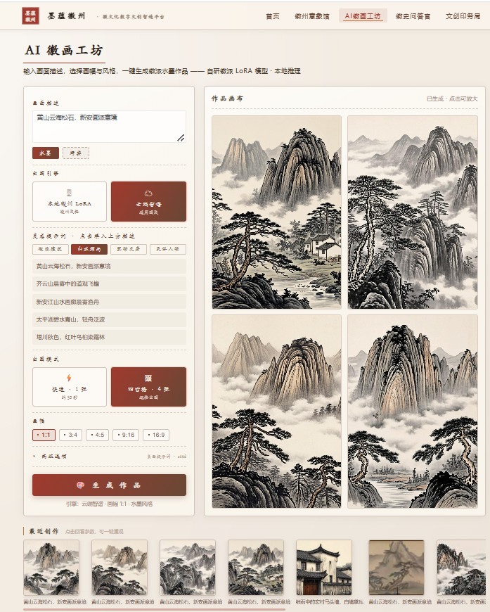
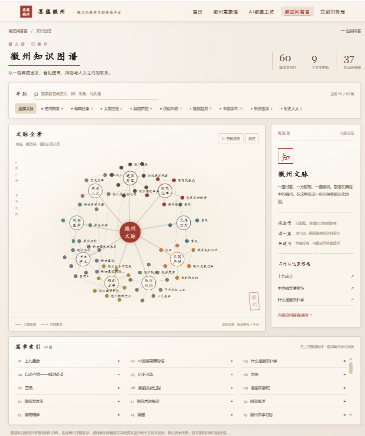
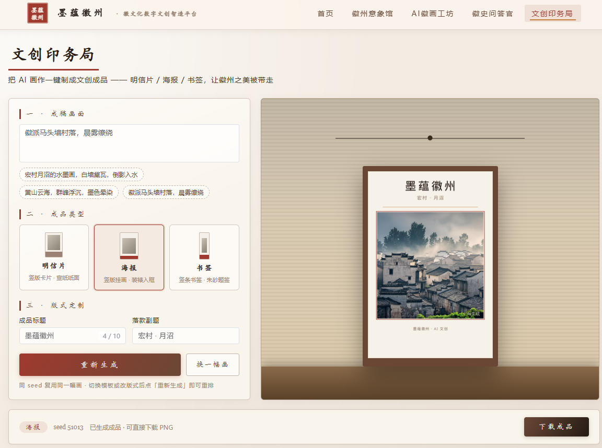
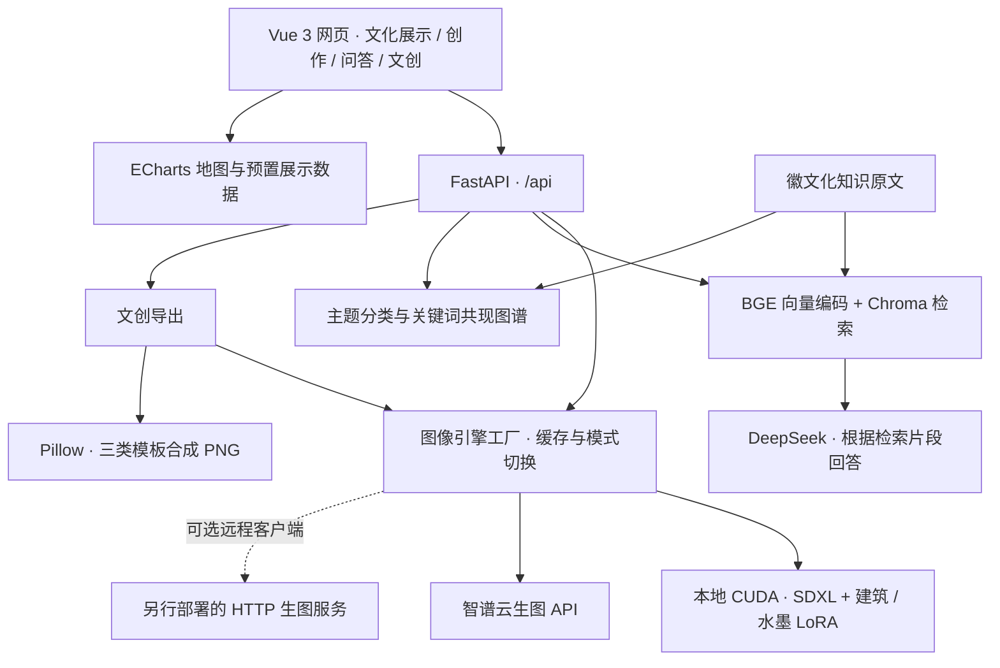

<p align="center">
  
</p>

<h1 align="center">墨蕴徽州 · MoJyun Huizhou</h1>

<p align="center">徽文化数字文创智造平台<br>画出徽州，讲出徽州，做出文创</p>

<p align="center">
  <a href="LICENSE"></a>
  
  
  
</p>

墨蕴徽州是面向徽文化体验与数字文创设计的 AIGC 应用，将文化地图、徽派图像创作、知识问答、原文关联阅读和文创排版放在同一网站。游客和研学学生可以先了解一个文化主题，再描述画面、生成作品，制作明信片、海报或书签样稿；景区体验点、学校和活动组织者可以围绕主题组织互动创作。

项目用于 **2026 年 iCAN 大学生创新创业大赛创新赛道·智慧文创方向**。本仓库发布前后端源码、知识文本和已有项目材料，供学习、复现与继续开发。模型权重、训练数据集、API 密钥及运行环境需单独准备。

[功能介绍](#功能介绍) · [界面预览](#界面预览) · [架构与技术栈](#架构与技术栈) · [快速开始](#快速开始) · [未来工作](#未来工作) · [许可证](#许可证)

## 项目思路

徽文化包含马头墙、白墙黛瓦、文房四宝、徽商故事和传统技艺等丰富内容。项目将这些内容组织为可以浏览、提问和动手创作的体验，减少用户在资料网站、聊天工具、绘画工具和排版软件之间切换的步骤。

- **针对题材适配生成模型**：以 SDXL 为基础，分别训练徽派建筑和水墨风格 LoRA，在推理时组合两枚权重，并提供易于选择的风格预设。
- **让问答连接原文阅读**：问答检索与主题图谱共用知识文本，用户既可以查一个问题，也可以按主题阅读资料及相关篇章。
- **围绕活动成果组织功能**：文化浏览、画面生成与三类文创模板服务于同一主题下的学习和创作，输出可展示、分享及继续打样的数字样稿。

LoRA、RAG 和多适配器组合均采用已有技术。项目工作集中在徽文化素材整理、题材适配、知识组织、交互设计与服务集成。景区活动服务、主题模板定制与部署支持是拟探索的应用方向，尚不代表已验证的商业成果。

## 功能介绍

| 模块 | 当前能力 | 页面 |
| --- | --- | --- |
| 徽州意象馆 | 安徽地图、文化景点分布、非遗名录与展示看板 | `/bigscreen` |
| AI 徽画工坊 | 提示词引导、水墨/写实预设、五种画幅、单张/四宫格生成、放大下载、近期作品缩略图 | `/studio` |
| 徽史问答官 | 本地知识检索、DeepSeek 回答、检索片段查看与会话交互 | `/ask` |
| 知识图谱阅读 | 主题筛选、篇名及全文搜索、原文阅读、关键词关联与延伸提问 | `/ask/knowledge` |
| 文创印务局 | 输入描述、标题和副题，生成底图并排版为明信片、海报或书签，下载 PNG | `/craft` |

知识图谱是问答模块的阅读入口，因此产品整体仍按四个模块组织。图谱直接读取原文生成，无需启动向量模型或调用大模型；关联边表示篇章中**共同出现的关键词**，用于提示阅读线索。

### 当前实现边界

- **图像引擎**：界面提供 `local` 与 `api` 切换。`local` 使用 SDXL 与自训 LoRA；`api` 调用智谱云端接口，不加载本地 LoRA，当前适配器不传递负向提示词、seed 和风格权重。代码还保留 `remote` HTTP 客户端，需要另行部署符合接口约定的远程服务。
- **问答依据**：接口返回 `answer` 与 `sources` 原文片段。知识条目的原始出版来源、许可记录和稳定引用编号仍需完善；有检索上下文并不保证每次回答都正确。
- **文创排版**：当前 `/api/export` 每次都会调用生图引擎，再使用 Pillow 合成模板。工坊作品直接进入文创、切换模板复用同一底图列入后续工作；相同 seed 不能代替作品保存，云端模式也不使用 seed。
- **数据看板**：统计指标含预置数值，代码中保留部分公开数据的来源注记，但尚未建立统一的数据更新接口。截图中的数字不作为实时统计或项目运营成绩。
- **部署范围**：当前适合受控环境下的开发和演示，尚未提供完整的用户认证、任务队列、多用户配额与生产运维体系。

## 界面预览

以下图片提取自省赛最终答辩材料中的原始界面截图，保留完整比例。它们记录了演示版本的界面，不代表在线服务状态或本次重新完成了模型推理。


<details>
<summary>AI 徽画工坊：提示词、风格与四宫格作品</summary>



</details>

<details>
<summary>徽史问答官：先检索资料，再组织回答</summary>


</details>

<details>
<summary>知识图谱：主题浏览与原文关联阅读</summary>



</details>

<details>
<summary>文创印务局：画面、标题与模板合成</summary>



</details>

## 架构与技术栈

平台采用前后端分离架构。Vue 单页应用负责交互，FastAPI 路由将请求分发到生图、知识服务与文创排版模块。



| 层次 | 技术 | 用途 |
| --- | --- | --- |
| 前端 | Vue 3、Vue Router、Vite、Element Plus、Axios、Sass | 页面、交互组件、路由与 API 调用 |
| 可视化 | ECharts、autofit.js、odometer | 文化地图、原文关联图谱与大屏展示 |
| 后端 | FastAPI、Uvicorn、Pydantic Settings、HTTPX | 请求校验、配置加载、HTTP 服务与模型接口调用 |
| 本地生图 | PyTorch、Diffusers、PEFT、SDXL、双 LoRA | 建筑题材与水墨风格生成 |
| 云生图 | 智谱图像生成接口，当前代码使用 `glm-image` | 联网生图备选路径 |
| 知识问答 | Sentence Transformers、`bge-base-zh-v1.5`、ChromaDB、DeepSeek API | 本地编码与检索、云端回答 |
| 文创合成 | Pillow、系统中文字体 | 模板排版及 PNG 导出 |
| 回归验证 | Python `unittest`、FastAPI TestClient | 知识图谱逻辑和接口契约 |

### 徽派双 LoRA

省赛最终答辩材料记录：采集素材 308 张，经检查和筛选形成 288 张候选素材；实际分组训练使用建筑图 129 张、水墨图 110 张。训练设备为 RTX 4090 24GB，采用 bf16、rank/alpha 64、1024×1024 分辨率与 batch size 1。

当前推理代码依次加载建筑、水墨两枚 LoRA。适配器系数分别为：`ink` 水墨预设 **0.4 / 1.2**，`photo` 写实预设 **1.2 / 0.4**，`balanced` 平衡预设 **1.2 / 1.2**。系数作用于已处理的交付权重，不能直接当成任意 LoRA 的通用参数。

本仓库提供推理与产品集成代码，**未包含上述训练图片、完整训练脚本和 LoRA 权重**。训练记录用于说明项目过程，尚不足以通过本仓库独立复现整个训练实验；生成质量、文化准确性和服务性能的量化评测仍列入后续工作。

## 快速开始

### 1. 准备环境

- 推荐 Python **3.11**，Python 3.13 的完整依赖兼容性尚未验证。
- 前端建议使用 Node.js **22** 与 npm，依赖版本由 `frontend/package-lock.json` 锁定。
- 展示页面不依赖 GPU；问答需要本地 BGE 模型和 DeepSeek API；云生图需要相应 API 密钥和网络。
- 本地生图另需兼容的 NVIDIA CUDA GPU、PyTorch、SDXL 基础模型和自训 LoRA。训练记录中的 24GB 显卡不等于最低推理显存要求。

```bash
git clone https://github.com/shijiu0121/moyunhuizhou.git
cd moyunhuizhou
python -m venv backend/.venv
```

### 2. 后端安装与配置

在仓库根目录激活环境，然后安装后端依赖、复制配置：

```powershell
# Windows PowerShell
.\backend\.venv\Scripts\Activate.ps1
cd backend
python -m pip install -r requirements.txt
Copy-Item .env.example .env
```

```bash
# Linux / macOS
source backend/.venv/bin/activate
cd backend
python -m pip install -r requirements.txt
cp .env.example .env
```

编辑 `backend/.env`。先使用云生图时，至少设置如下字段，并填写自己的密钥：

```dotenv
DEEPSEEK_API_KEY=your-deepseek-key
DEEPSEEK_BASE_URL=https://api.deepseek.com
DEEPSEEK_MODEL=deepseek-chat
IMAGE_GEN_MODE=api
CLOUD_IMAGE_API_KEY=your-image-api-key
CLOUD_IMAGE_API_URL=https://open.bigmodel.cn/api/paas/v4/images/generations
CORS_ORIGINS=http://localhost:5173
```

包内 `.env.example` 默认选择 `local`，仅复制文件不会获得可运行的本地模型。真实 `.env` 受 Git 忽略，不应提交。云端服务的可用模型、账户权限与计费以对应平台为准。

### 3. 准备按需使用的模型

**知识问答**需要将 [BAAI/bge-base-zh-v1.5](https://huggingface.co/BAAI/bge-base-zh-v1.5) 完整模型文件放到 `backend/app/data/models/bge-base-zh-v1.5/`，目录需包含 `config.json` 等必要文件。当前代码读取本地目录，不会自动下载。

知识原文已放在 `backend/app/data/*.txt`；首次问答会切块、编码并建立 `vector_store/`。已有索引非空时会跳过构建，修改原文后需自行备份并重建索引。图谱直接读取原文，更新不依赖向量索引。

**本地生图**还需要：

1. 按部署机器的 CUDA 环境安装兼容的 PyTorch，再安装 `diffusers transformers accelerate peft safetensors`，详见 `backend/requirements.txt` 末尾可选依赖说明。
2. 准备 [SDXL 基础模型](https://huggingface.co/stabilityai/stable-diffusion-xl-base-1.0)。当前 `backend/app/image_gen/local_sd.py` 将 `model_id` 默认写为 `/root/autodl-tmp/sdxl-base`，更换部署机器时需将代码中的路径改为实际模型目录；当前尚无 `.env` 基础模型路径选项。
3. 单独取得项目建筑、水墨 LoRA，按以下路径放置，并配置 `IMAGE_GEN_MODE=local` 和 `IMAGE_GEN_LORA_PATH`：

```text
backend/models/lora/lora_building_03.safetensors
backend/models/lora/lora_shuimo_05.safetensors
```

只有模型完整落地后，本地生图才可离线运行；问答回答阶段仍会访问 DeepSeek API。若只浏览知识图谱，不需要准备这些模型或密钥。

### 4. 启动服务

在已激活环境的 `backend/` 终端中：

```bash
python -m uvicorn app.main:app --reload --host 127.0.0.1 --port 8000
```

另开终端，在仓库根目录执行：

```bash
cd frontend
npm ci
npm run dev
```

- 网站：[http://localhost:5173](http://localhost:5173)
- 后端 API 文档：[http://localhost:8000/docs](http://localhost:8000/docs)
- 无模型阅读入口：[http://localhost:5173/ask/knowledge](http://localhost:5173/ask/knowledge)

Vite 开发服务器将 `/api` 代理到 `localhost:8000`。`npm run build` 生成 `frontend/dist/`；正式托管时需另外配置 `/api` 反向代理及 SPA 路由回退，`vite preview` 仅用于检查构建产物。

### 5. 回归验证与常见问题

```bash
# backend/：图谱与接口契约测试，不执行真实生图或大模型调用
python -m unittest discover -s tests -v

# frontend/：生产构建
npm run build
```

| 现象 | 检查项 |
| --- | --- |
| 图谱有内容，但问答失败 | BGE 模型目录、DeepSeek 密钥、网络与索引状态；两条链路的依赖不同 |
| 本地模式加载失败 | SDXL 固定路径、CUDA/PyTorch 版本、LoRA 文件与加载顺序 |
| 云端无法切换或生图失败 | `CLOUD_IMAGE_API_KEY`、接口权限、地址、额度与平台响应 |
| PNG 中文缺字 | 系统中文字体；Linux 可安装 `fonts-wqy-microhei`，字体候选见 `composer.py` |
| 切换引擎后行为不一致 | 当前切换依赖单个服务进程的内存状态；先使用单进程 Uvicorn |

## API 概览

| 方法 | 路径 | 输入 / 输出 |
| --- | --- | --- |
| `GET` | `/` | 项目信息 |
| `POST` | `/api/generate` | 提示词、风格、画幅与 seed；返回图片字节 |
| `GET` / `POST` | `/api/gen-mode` | 查询 / 切换当前生图模式 |
| `POST` | `/api/ask` | `question`；返回 `answer` 与 `sources` |
| `GET` | `/api/ask/knowledge-graph` | 原文、主题、节点、关联边及统计 |
| `POST` | `/api/export` | 提示词、标题、副题、模板与 seed；返回合成 PNG |
| `GET` | `/api/tour/overview` | 预置景点与分类示例数据 |

请求字段与默认值以运行后的 OpenAPI 文档和 `backend/app/routes/` 为准。当前没有内置认证与调用限额，开放到公网前应补齐访问控制、请求限制与资源隔离。

## 目录结构

```text
.
├── backend/
│   ├── app/
│   │   ├── routes/          # API 路由
│   │   ├── image_gen/       # 本地 / 云端 / 可选远程引擎
│   │   ├── rag/             # 知识读取、向量检索、问答与图谱
│   │   ├── export/          # Pillow 文创模板
│   │   └── data/            # 知识文本，模型及索引需单独准备
│   ├── tests/               # 知识图谱回归测试
│   ├── .env.example
│   └── requirements.txt
├── frontend/               # Vue 3 应用与依赖锁文件
├── docs/                   # 项目材料、交付说明与界面截图
├── brand/                  # 既有标识素材
├── deliverables/           # 宣传海报、图谱预览与历史交付包
├── LICENSE                 # 原创软件代码的 MIT 许可证
├── THIRD_PARTY_NOTICES.md   # 素材、知识文本及模型的授权边界
├── manifest.json           # 当前源码文件清单与校验值
└── SHA256SUMS              # 当前源码文件 SHA-256 清单
```

## 未来工作

以下项目为规划，尚未因列入本表而实现。

| 优先级 | 方向 | 计划与验证方式 |
| --- | --- | --- |
| 近期 | 完成作品流转 | 用作品 ID 或原图连接工坊、模板与下载；切换模板只重新排版，验证底图一致并减少重复推理 |
| 近期 | 提升知识可追溯性 | 补齐资料 URL、作者、日期与许可，返回结构化引用；建立问题集核对引用命中、答案依据和拒答行为 |
| 近期 | 提升部署与运行稳定性 | 配置化模型路径、锁定后端依赖，补齐健康检查、错误反馈、超时、任务队列和模型切换并发控制 |
| 近期 | 整理素材与统计口径 | 核实图片与文本授权，替换来源不完整的素材；明确演示字段并接入有来源、时间和口径的数据 |
| 中期 | 建立生成评测 | 固定提示词和随机种子，对比基础 SDXL、单 LoRA、双 LoRA，记录文化元素表现、失败样例、耗时与显存 |
| 中期 | 开展小规模试用 | 在景区体验或研学活动中记录上手时间、作品完成率、组织成本与用户反馈，据此调整功能及服务方式 |
| 后续 | 丰富主题与模板 | 逐步扩展建筑、徽商与传统技艺主题，探索更多文创尺寸、打印规范和定制部署 |

## 项目材料与参与开发

- [交付说明](docs/交付说明.md)：部署背景、模型文件与运行注意事项。
- [项目技术方案书](docs/项目技术方案书.md)：早期设计与功能规划。
- [知识图谱交付说明](docs/知识图谱交付说明.md)：图谱实现、验证与接入方式。
- [数据来源清单](docs/数据来源清单.md)：当前来源记录，仍含待补项。
- [开发日志](docs/开发日志.md)、[开发日志 Word 材料](docs/开发日志.docx)：已有开发过程材料。
- [源码同步说明](docs/SOURCE_IMPORT.md)：本次源包合并、校验与文档依据。

部分历史材料保留早期选型和计划，例如 `bge-m3`、远程模式及同图复用描述。**当前运行行为以源码和本 README 的实现边界为准。**

欢迎通过 [Issues](https://github.com/shijiu0121/moyunhuizhou/issues) 提交可复现问题或改进建议。提交改动时说明使用场景与验证结果，界面改动附截图，新增模型或知识资料附来源及授权说明。请勿提交真实密钥、用户数据、模型权重、向量索引和依赖目录。

## 许可证

项目原创软件代码及本 README 采用 [MIT License](LICENSE)，允许在保留版权与许可声明的条件下使用、修改和分发，包括商业使用。许可证说明参见 [GitHub Choose a License](https://choosealicense.com/licenses/mit/)。

**代码许可不覆盖第三方图片、知识原文、模型权重、训练数据、品牌标识及比赛宣传材料。** 这些内容需依据各自来源和授权使用，详见 [第三方内容与授权说明](THIRD_PARTY_NOTICES.md)。数据来源清单尚未补齐，公开可访问的内容也不能据此认定可自由再分发或商用。

感谢 Vue、Vite、FastAPI、ECharts、Diffusers、SDXL、BGE、Chroma、Pillow 及相关开源项目提供的基础能力。DeepSeek 与智谱 API 的使用另受各自服务条款约束。
